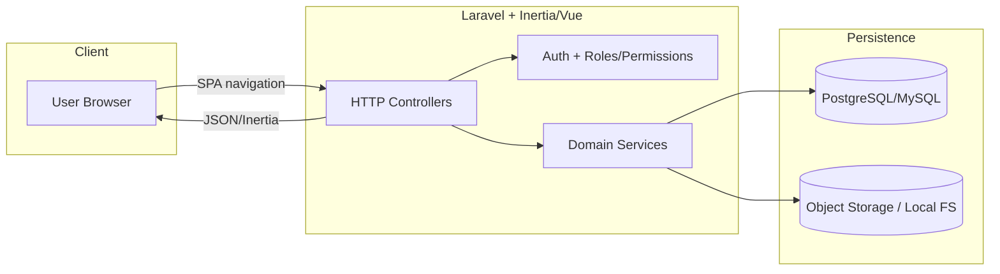
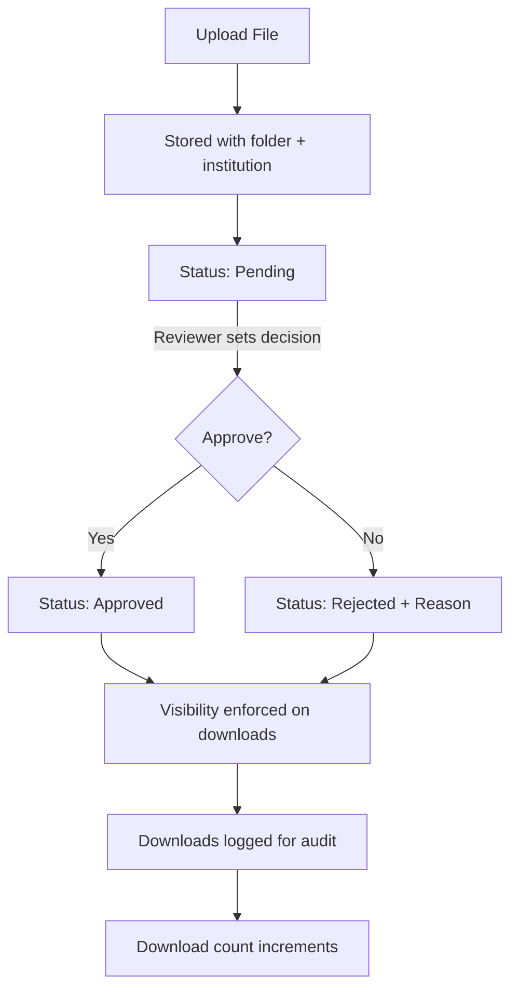
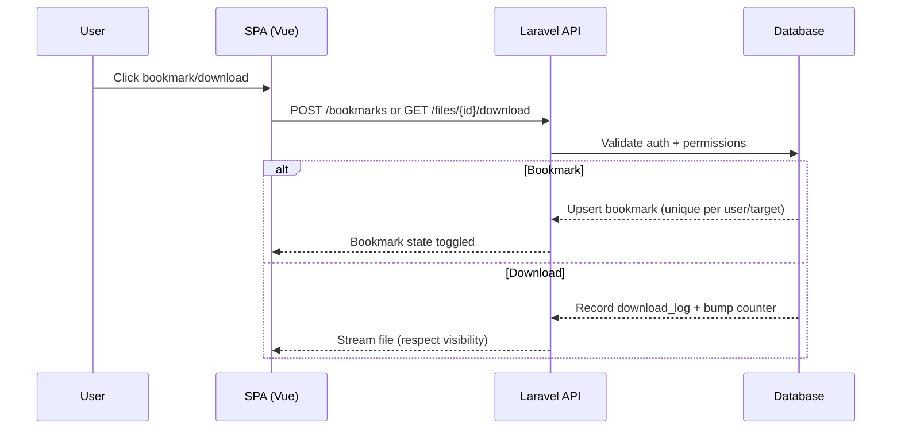
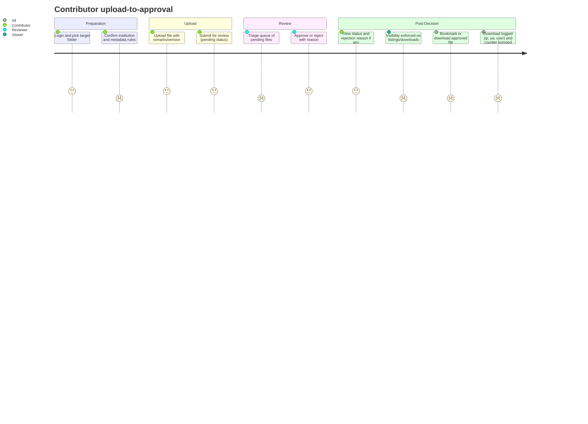

# Diagrams

## System Context


## File Lifecycle


## Bookmark & Download Interaction


## User Journey (Contributor to Approval to Consumption)


## Workflow (Permissioned Download and Logging)
```mermaid
flowchart TD
    A[User requests download] --> B{Authenticated?}
    B -- No --> X[Reject or prompt login]
    B -- Yes --> C{Visibility}
    C -- Public --> D[Allow]
    C -- Restricted --> E{Has required role or permission?}
    E -- No --> X
    E -- Yes --> D
    C -- Private --> F{Owner/Uploader or Admin?}
    F -- No --> X
    F -- Yes --> D
    D --> G[Record download_log (ip, ua, user)]
    G --> H[Increment download count]
    H --> I[Stream file]
```
