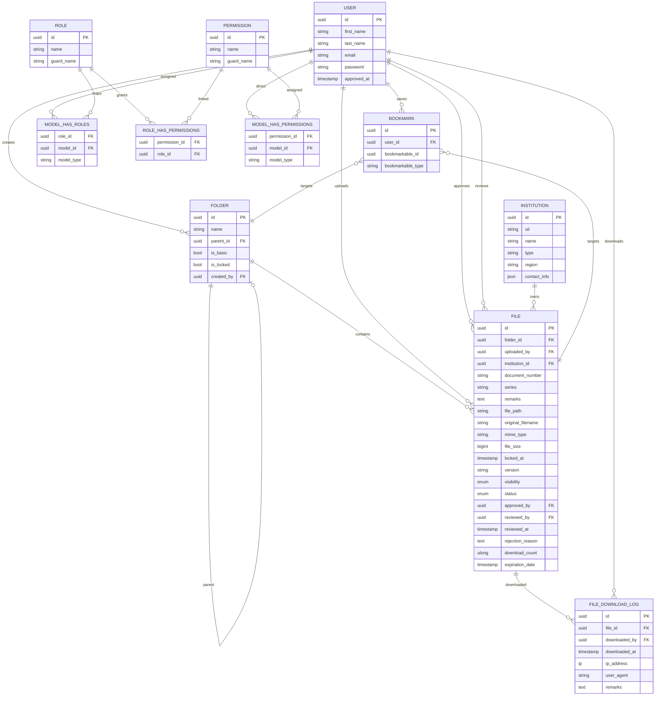

# Data Model ERD

The diagram reflects the current Laravel models and migrations (files, folders, institutions, bookmarks, download logs, users, and Spatie permission tables).

**Notes**
- Bookmarks are polymorphic; current bookmarkable targets are `files` and `folders`.
- Soft deletes exist on `files`, `folders`, and `bookmarks`; cascades are set on folders→files, files→download logs, and bookmarks unique per user/target.
- Visibility/state fields (`visibility`, `status`, `is_locked`, `locked_at`, `approved_at`) are modeled for review/approval workflows.
