# System Diagrams
## RACKS v2.0: Knowledge Management Information System

This document contains technical and non-technical diagrams to visualize system architecture, workflows, and user journeys.

---

## Table of Contents
1. [System Context (High-Level)](#1-system-context)
2. [System Architecture](#2-system-architecture)
3. [Document Lifecycle (Explicit Knowledge)](#3-document-lifecycle)
4. [Knowledge Entry Workflow (Tacit Knowledge)](#4-knowledge-entry-workflow)
5. [Search & Discovery Flow](#5-search--discovery-flow)
6. [Retention & Archival Automation](#6-retention--archival-automation)
7. [User Journeys](#7-user-journeys)
8. [Data Flow Diagrams](#8-data-flow-diagrams)
9. [Deployment Architecture](#9-deployment-architecture)

---

## 1. System Context

### High-Level Overview

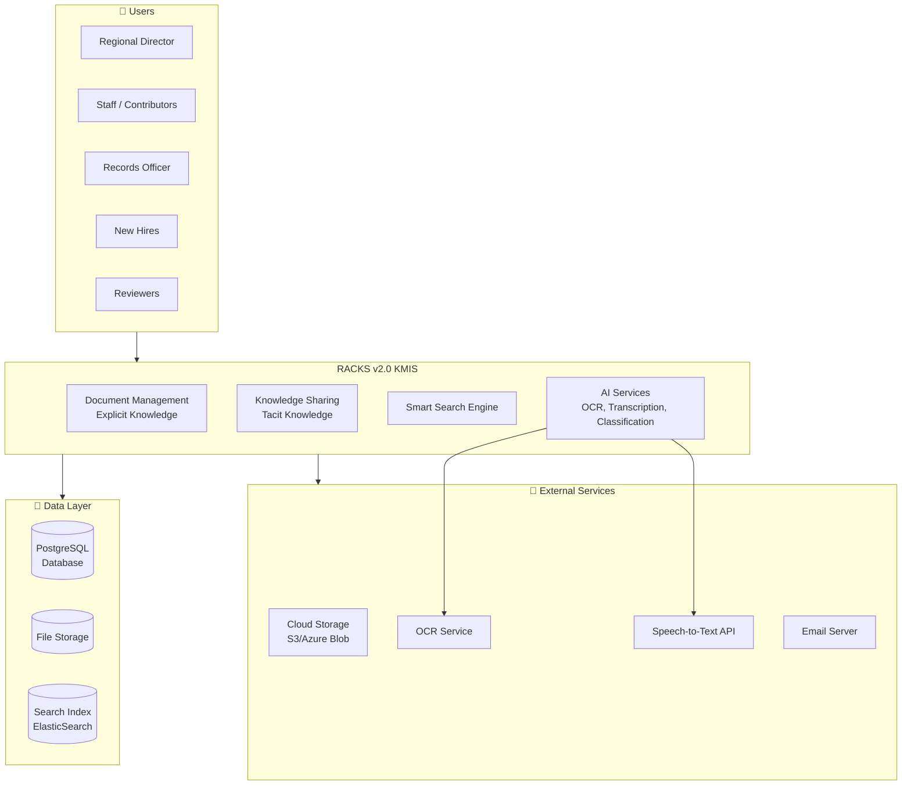

**Non-Technical Explanation**:
- **Users** interact with the system through web browsers or mobile devices
- **RACKS KMIS** has two main parts:
  - **Document Management**: Store, organize, and retrieve official documents
  - **Knowledge Sharing**: Capture learnings from travels, meetings, and mentoring
- **Smart Search** helps find documents and knowledge quickly
- **AI Services** automatically process documents (read scanned text, transcribe audio)
- **External Services** handle file storage, email notifications
- **Data Layer** stores all information securely

---

## 2. System Architecture

### Technical Architecture

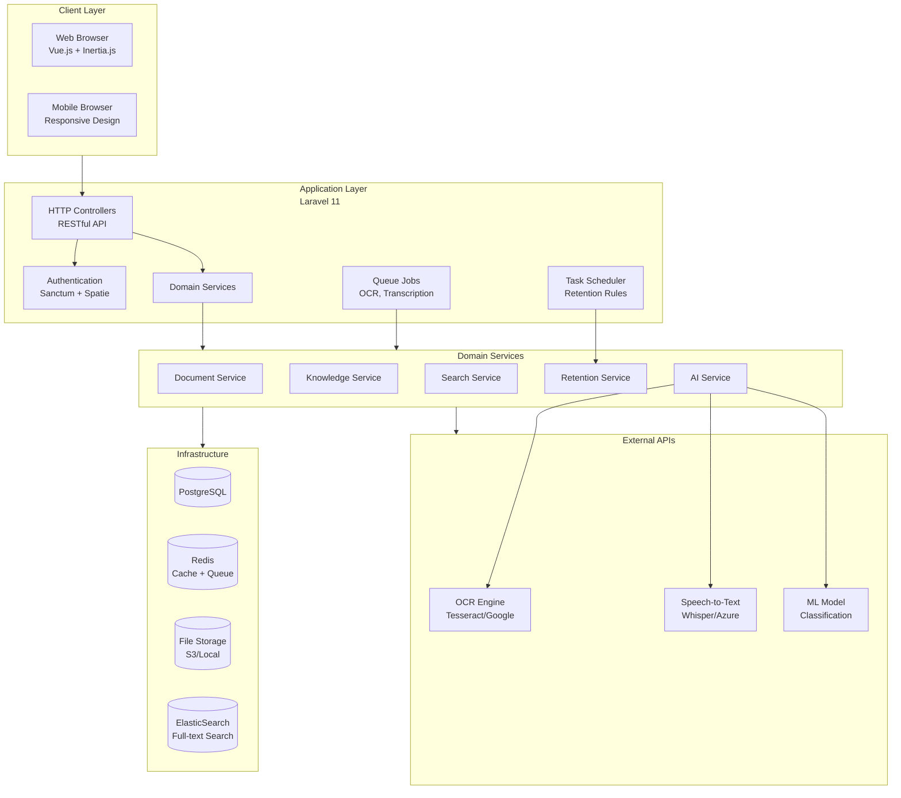

**Technical Components**:
- **Frontend**: Vue.js SPA with Inertia.js for seamless navigation
- **Backend**: Laravel 11 (PHP) with service-oriented architecture
- **Database**: PostgreSQL for relational data + JSONB for flexible fields
- **Cache & Queue**: Redis for performance and async processing
- **Search**: ElasticSearch for advanced full-text search
- **AI Integration**: External APIs for OCR, transcription, classification

---

## 3. Document Lifecycle

### From Upload to Disposal (Explicit Knowledge)

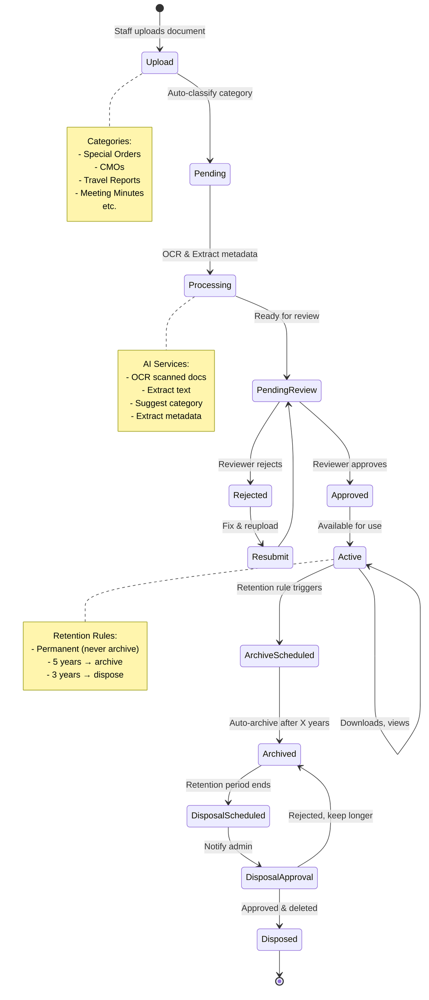

**Non-Technical Explanation**:
1. **Upload**: Staff uploads a document and selects folder
2. **Auto-Classify**: System suggests document type (e.g., "Travel Report")
3. **OCR Processing**: If scanned, system reads text to make it searchable
4. **Review**: Designated reviewer checks quality and approves
5. **Active Use**: Document is available for everyone to search and download
6. **Auto-Archive**: After retention period (e.g., 5 years), system archives it
7. **Disposal**: After total retention, system requests approval to delete

---

## 4. Knowledge Entry Workflow

### Capturing Tacit Knowledge

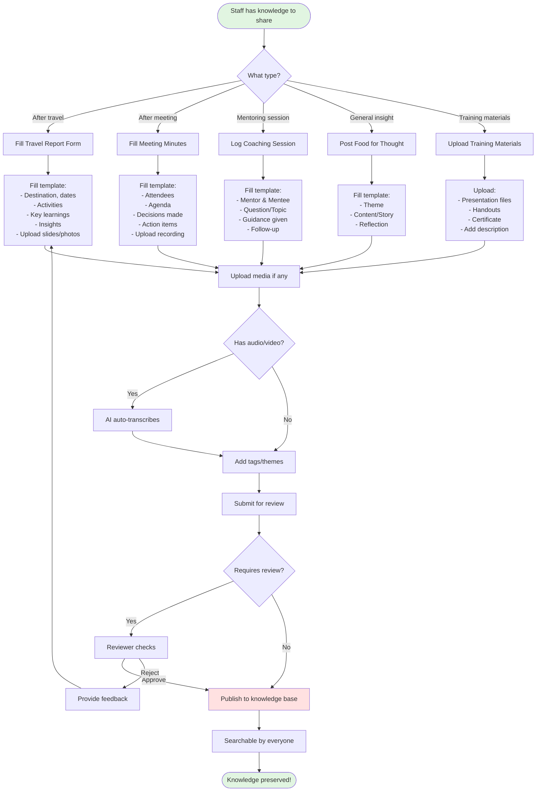

**Non-Technical Explanation**:
1. **Choose Type**: Staff selects what kind of knowledge they're sharing
2. **Fill Template**: System provides structured form with relevant fields
3. **Upload Media**: Optional attachments (slides, recordings, photos)
4. **AI Processing**: System transcribes audio/video automatically
5. **Tag**: Staff adds themes (e.g., "scholarship", "accreditation")
6. **Review**: Optional approval step for quality control
7. **Publish**: Knowledge becomes searchable and accessible to all

---

## 5. Search & Discovery Flow

### Multi-Angle Search

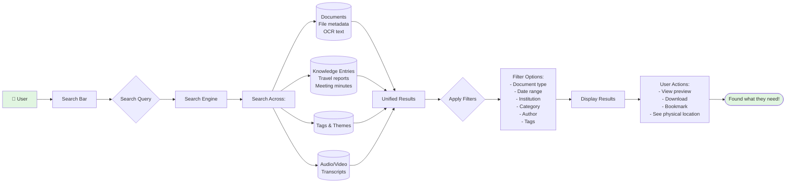

**Search Capabilities**:
- **All-Angle Search**: Search within:
  - Document titles and descriptions
  - OCR text from scanned documents
  - Knowledge entry content
  - Audio/video transcripts
  - Tags and categories
- **Smart Filters**: Narrow down by type, date, author, institution
- **Preview**: See snippets before downloading
- **Physical Location**: Find where original paper copy is stored

---

## 6. Retention & Archival Automation

### Automated Lifecycle Management

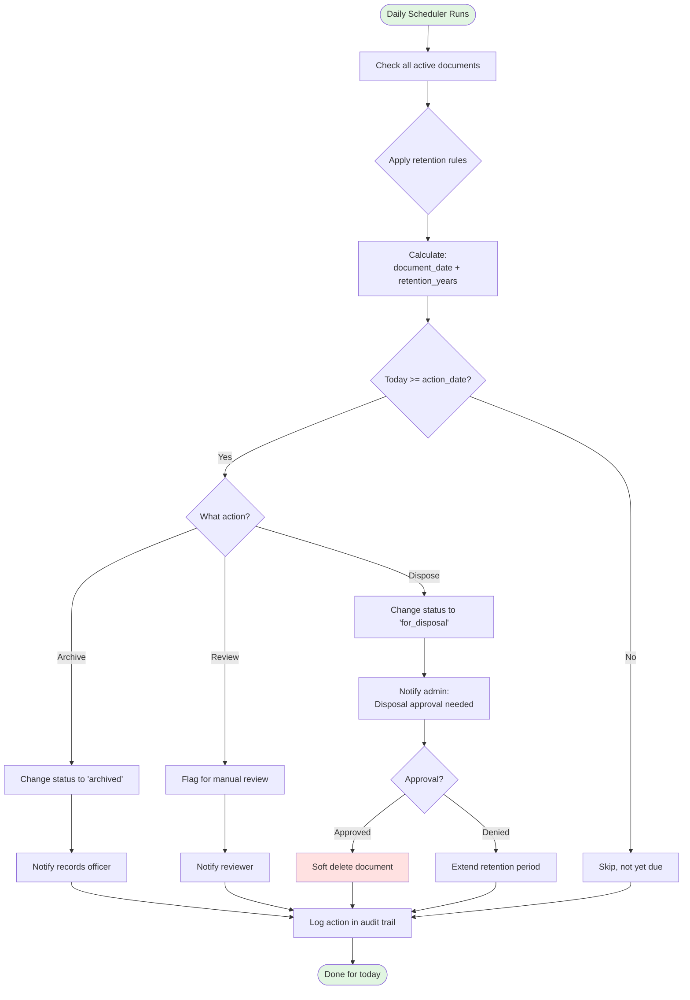

**Retention Rules Examples**:
- **Permanent Records** (CMOs, Policies): Never dispose
- **Travel Reports**: Archive after 5 years
- **Routine Memos**: Dispose after 3 years
- **Meeting Minutes**: Archive after 7 years
- **Special Orders**: Archive after 10 years

**Automation Benefits**:
- No manual tracking needed
- Compliance with records retention laws
- Email alerts before actions taken
- Approval workflow for disposal

---

## 7. User Journeys

### Journey 1: New Employee Onboarding

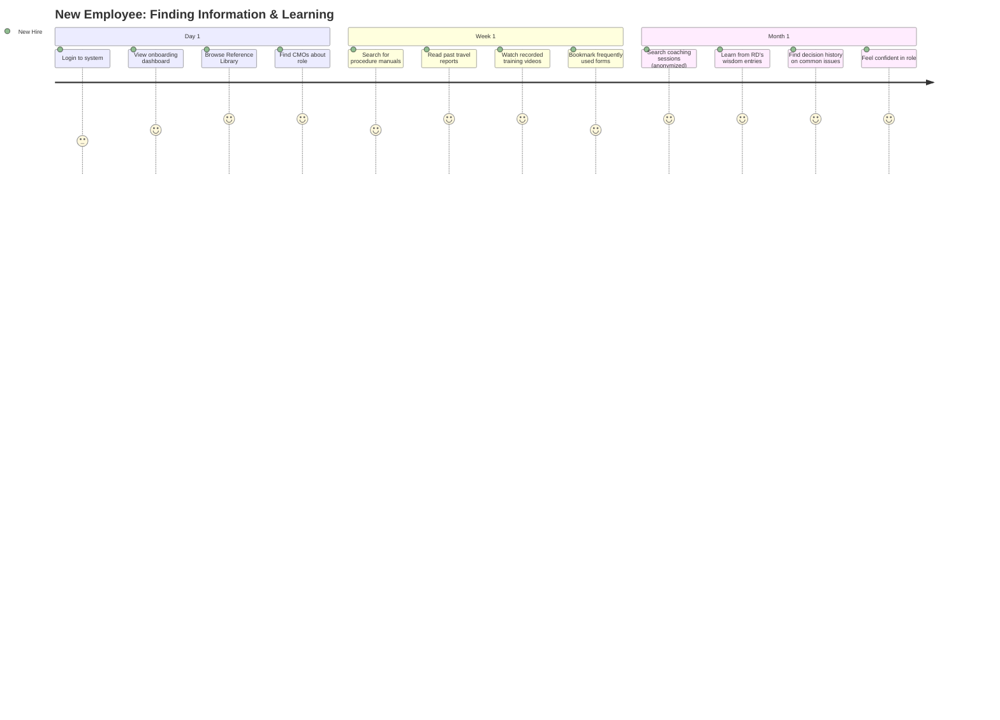

**Pain Points Solved**:
- ✅ No need to ask colleagues repeatedly
- ✅ Access to institutional memory
- ✅ Learn from past experiences
- ✅ Find forms and procedures instantly

---

### Journey 2: Staff Member After Training

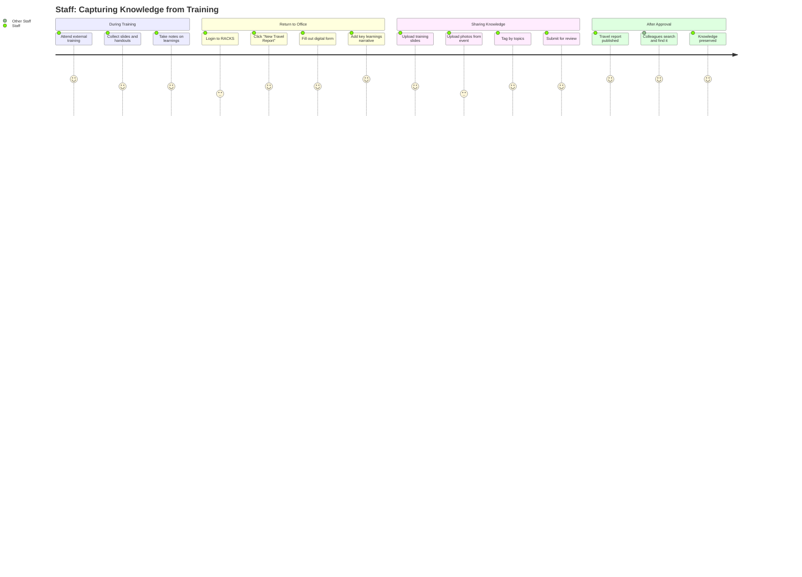

**Before RACKS v2**:
- ❌ Print form, hand-write, scan, email
- ❌ Training materials lost or in personal folders
- ❌ No one else learns from your training

**After RACKS v2**:
- ✅ Digital form, no printing
- ✅ Materials centrally stored and searchable
- ✅ Everyone benefits from your learning

---

### Journey 3: Records Officer Managing Documents

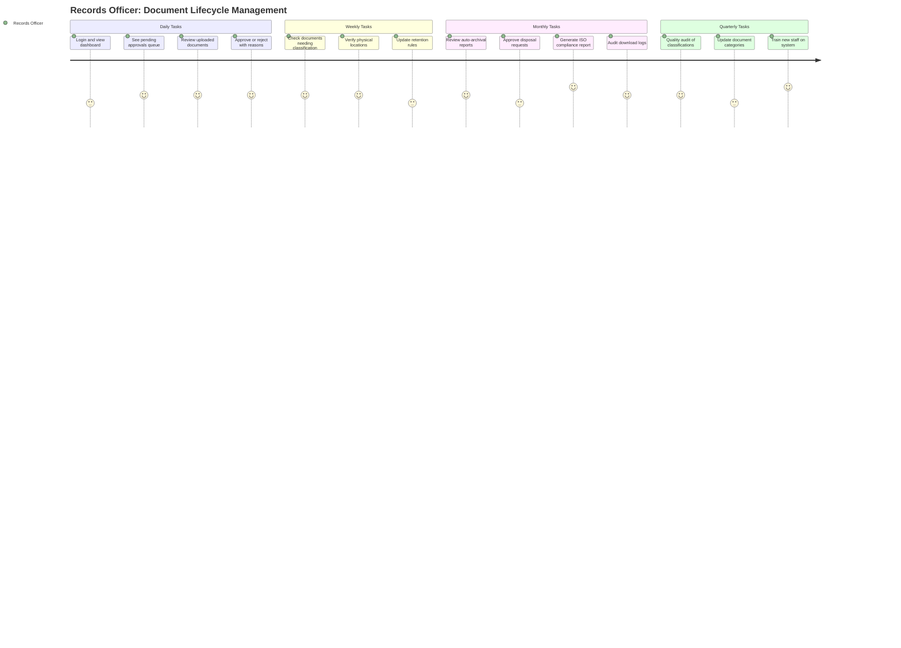

**Key Features Used**:
- Dashboard with pending counts
- One-click approve/reject
- Auto-classification suggestions
- Retention automation
- ISO compliance reports

---

### Journey 4: Regional Director Sharing Wisdom

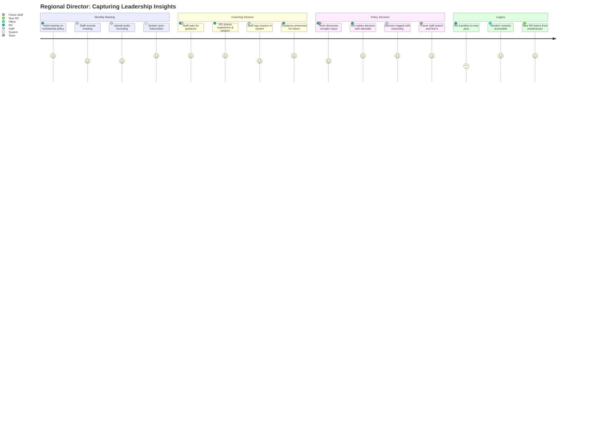

**Legacy Preservation**:
- Leadership insights captured systematically
- Decisions with rationale preserved
- Organizational memory survives personnel changes
- Continuous learning culture

---

## 8. Data Flow Diagrams

### Document Upload with AI Processing

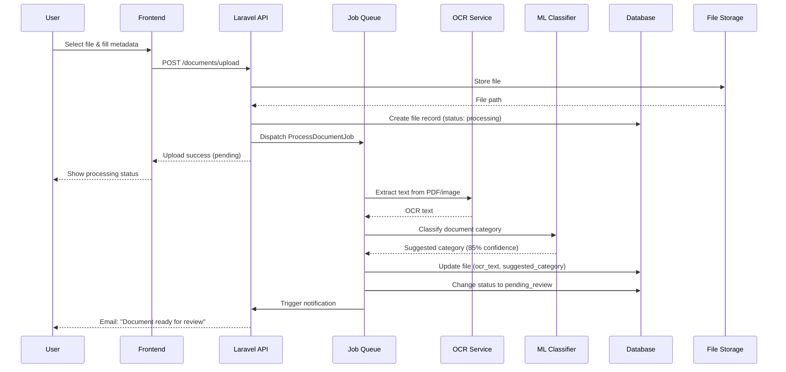

**Steps Explained**:
1. User uploads file with basic metadata
2. System stores file securely
3. Background job processes document:
   - OCR extracts text (if image/scanned PDF)
   - ML model suggests category
4. Document moves to review queue
5. Reviewer gets notification

---

### Knowledge Entry with Audio Transcription

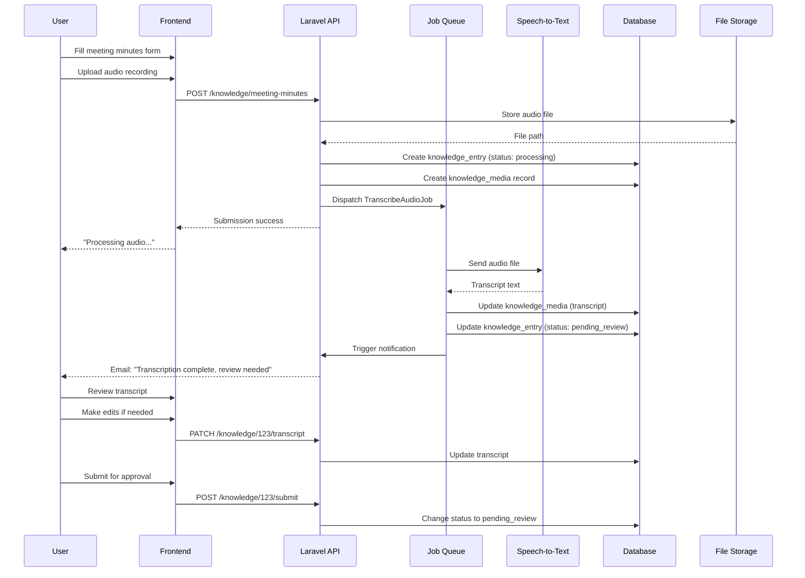

**Steps Explained**:
1. User fills knowledge entry form and uploads audio
2. System stores audio file
3. Background job sends audio to transcription service
4. Transcript saved to database
5. User can review and edit transcript
6. Submit for final approval

---

### Search Query Processing

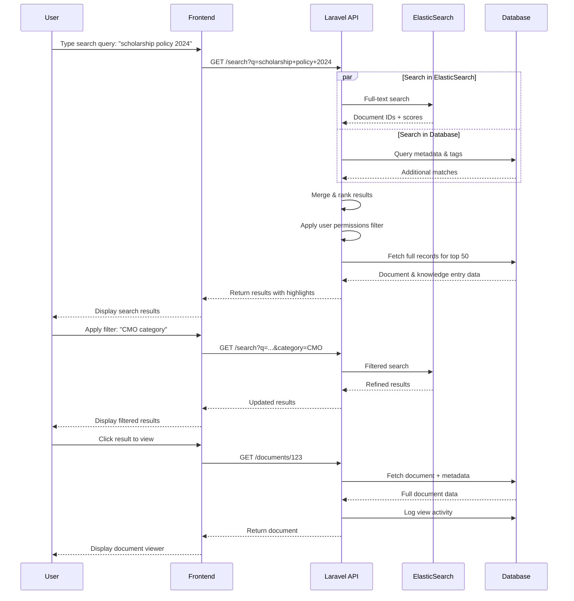

**Search Features**:
- Parallel search across multiple indexes
- Result ranking by relevance
- Permission filtering (user only sees allowed docs)
- Faceted filters (category, date, author)
- Activity logging

---

## 9. Deployment Architecture

### Production Environment

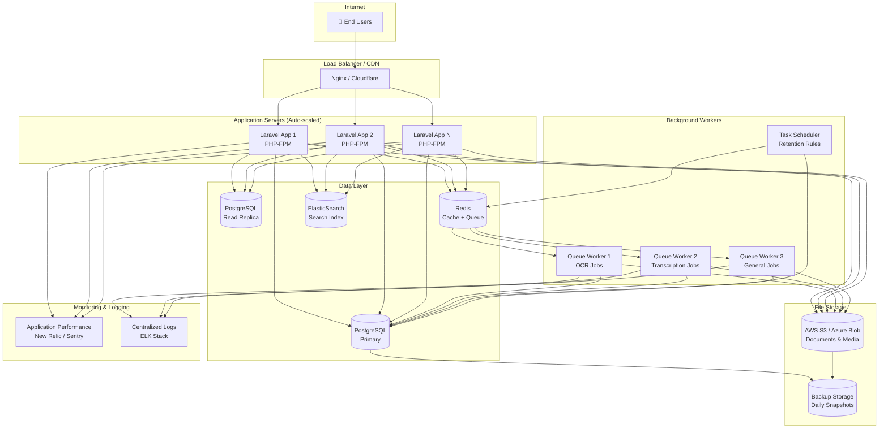

**Infrastructure Components**:
- **Load Balancer**: Distributes traffic across app servers
- **App Servers**: Multiple Laravel instances for high availability
- **Background Workers**: Process heavy tasks asynchronously
- **Database**: Primary for writes, replica for read-heavy queries
- **Redis**: Caching and job queue management
- **ElasticSearch**: Full-text search index
- **Cloud Storage**: Scalable file storage with CDN
- **Monitoring**: Real-time error tracking and performance monitoring

**Scalability**:
- Horizontal scaling: Add more app servers as users grow
- Database replication: Read replicas for search and reporting
- Queue workers: Scale workers based on job volume
- CDN: Fast file delivery worldwide

---

## 10. Security Architecture

### Authentication & Authorization Flow

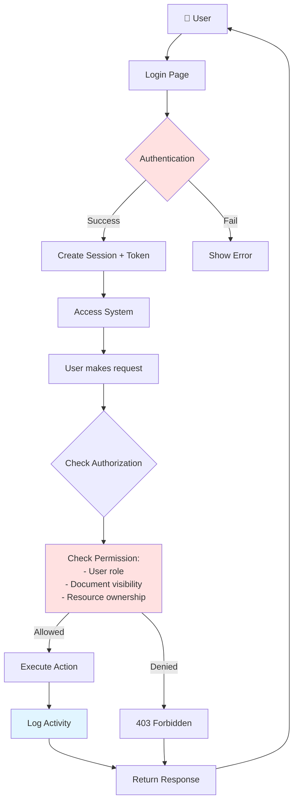

**Security Measures**:
- **Authentication**: Laravel Sanctum (SPA token-based)
- **Authorization**: Spatie Permissions (role + permission)
- **Data Encryption**: Files encrypted at rest, TLS in transit
- **Audit Logging**: All access and modifications logged
- **Rate Limiting**: Prevent abuse
- **CSRF Protection**: Token verification for forms
- **XSS Prevention**: Input sanitization and output encoding
- **File Validation**: MIME type checking, virus scanning

---

## Summary for Presentation

### For Non-Technical Stakeholders

**What RACKS KMIS Does**:
1. **Stores all office documents** in organized, searchable folders
2. **Makes everything findable** in seconds with smart search
3. **Captures staff knowledge** from travels, meetings, trainings
4. **Preserves leadership wisdom** for future generations
5. **Automates compliance** with records retention rules
6. **Tracks physical documents** so you can find paper copies

**Key Benefits**:
- ⏱️ **Save Time**: Find documents in <30 seconds instead of 15 minutes
- 🧠 **Preserve Knowledge**: No more lost expertise when people transfer
- 📚 **Easy Learning**: New employees onboard faster with reference library
- ✅ **Stay Compliant**: Automatic retention and disposal management
- 🔍 **Search Everything**: Even inside scanned documents and audio recordings

---

### For Technical Team

**Technology Stack**:
- **Frontend**: Vue.js 3 + Inertia.js
- **Backend**: Laravel 11 + PHP 8.2
- **Database**: PostgreSQL 15 (JSONB for flexible schemas)
- **Cache/Queue**: Redis 7
- **Search**: ElasticSearch 8
- **Storage**: AWS S3 / Azure Blob
- **AI Services**: 
  - OCR: Tesseract / Google Vision API
  - Transcription: OpenAI Whisper / Azure Speech
  - Classification: Custom ML model (Python FastAPI microservice)

**Key Technical Features**:
- Async job processing for heavy tasks (OCR, transcription)
- Full-text search with semantic understanding
- Automated retention rules engine
- Polymorphic relationships (bookmarks, media)
- Soft deletes with 30-day recovery
- Comprehensive audit logging
- Role-based access control (RBAC)
- Responsive design (mobile-first)

**Development Phases**:
1. **Phase 1** (Months 1-3): Enhanced document management
2. **Phase 2** (Months 4-6): Knowledge capture forms
3. **Phase 3** (Months 7-9): AI & automation
4. **Phase 4** (Months 10-12): Knowledge sharing features

---

**Document Control**
- **Version**: 2.0
- **Date**: January 2026
- **Author**: Development Team
- **Related**: RACKS_v2_PRD.md, RACKS_v2_ERD.md
