# Entity Relationship Diagram (ERD)
## RACKS v2.0: Knowledge Management Information System

This ERD extends the original document management system to support both **Explicit Knowledge** (documents) and **Tacit Knowledge** (experiences, wisdom, learnings).

---

## Mermaid ERD

```mermaid
erDiagram
    %% ========== USER & AUTH ==========
    USER ||--o{ FOLDER : "creates"
    USER ||--o{ FILE : "uploads"
    USER ||--o{ FILE : "approves"
    USER ||--o{ FILE : "reviews"
    USER ||--o{ FILE_DOWNLOAD_LOG : "downloads"
    USER ||--o{ BOOKMARK : "saves"
    USER ||--o{ KNOWLEDGE_ENTRY : "authors"
    USER ||--o{ COACHING_SESSION : "mentor"
    USER ||--o{ COACHING_SESSION : "mentee"
    USER ||--o{ MODEL_HAS_ROLES : "assigned"
    USER ||--o{ MODEL_HAS_PERMISSIONS : "direct"

    %% ========== FOLDERS & FILES (Explicit Knowledge) ==========
    FOLDER ||--o| FOLDER : "parent"
    FOLDER ||--o{ FILE : "contains"
    FOLDER }o--|| BOOKMARK : "targets"

    INSTITUTION ||--o{ FILE : "owns"

    FILE ||--o{ FILE_DOWNLOAD_LOG : "downloaded"
    FILE }o--|| BOOKMARK : "targets"
    FILE ||--o{ FILE_MEDIA : "has_media"
    FILE ||--o| PHYSICAL_LOCATION : "stored_at"
    FILE }o--|| DOCUMENT_CATEGORY : "classified_as"
    FILE }o--|| RETENTION_RULE : "governed_by"

    %% ========== DOCUMENT CLASSIFICATION & RETENTION ==========
    DOCUMENT_CATEGORY ||--o{ FILE : "contains"
    DOCUMENT_CATEGORY ||--o| RETENTION_RULE : "default_rule"

    RETENTION_RULE ||--o{ FILE : "applies_to"
    RETENTION_RULE ||--o{ DOCUMENT_CATEGORY : "default_for"

    PHYSICAL_LOCATION ||--o{ FILE : "houses"

    %% ========== TACIT KNOWLEDGE ==========
    KNOWLEDGE_ENTRY ||--o{ KNOWLEDGE_MEDIA : "includes"
    KNOWLEDGE_ENTRY ||--o{ KNOWLEDGE_TAG : "tagged_with"
    KNOWLEDGE_ENTRY }o--|| ENTRY_TYPE : "type"
    KNOWLEDGE_ENTRY }o--|| USER : "reviewed_by"

    TAG ||--o{ KNOWLEDGE_TAG : "applied_to"

    ENTRY_TYPE ||--o{ KNOWLEDGE_ENTRY : "entries"

    COACHING_SESSION ||--o{ COACHING_MEDIA : "recorded"
    COACHING_SESSION }o--|| USER : "reviewed_by_mentor"

    %% ========== PERMISSIONS ==========
    ROLE ||--o{ MODEL_HAS_ROLES : "maps"
    ROLE ||--o{ ROLE_HAS_PERMISSIONS : "grants"
    PERMISSION ||--o{ ROLE_HAS_PERMISSIONS : "linked"
    PERMISSION ||--o{ MODEL_HAS_PERMISSIONS : "assigned"

    %% ========== ENTITY DEFINITIONS ==========

    USER {
        uuid id PK
        string first_name
        string last_name
        string email
        string password
        string position
        string department
        timestamp approved_at
        timestamp email_verified_at
        timestamps created_updated
    }

    FOLDER {
        uuid id PK
        string name
        text description
        uuid parent_id FK
        bool is_basic
        bool is_locked
        uuid created_by FK
        timestamps created_updated
        timestamp deleted_at
    }

    FILE {
        uuid id PK
        uuid folder_id FK
        uuid uploaded_by FK
        uuid institution_id FK
        uuid category_id FK
        string document_number
        string series
        string title
        text description
        text remarks
        string file_path
        string original_filename
        string mime_type
        bigint file_size
        bool is_ocr_processed
        text ocr_text
        json extracted_metadata
        timestamp locked_at
        string version
        enum visibility
        enum status
        uuid approved_by FK
        uuid reviewed_by FK
        timestamp reviewed_at
        text rejection_reason
        ulong download_count
        timestamp expiration_date
        uuid physical_location_id FK
        enum retention_status
        timestamp auto_archive_date
        timestamp disposal_date
        bool disposal_approved
        timestamps created_updated
        timestamp deleted_at
    }

    INSTITUTION {
        uuid id PK
        string uii
        string name
        string type
        string region
        json contact_info
        bool is_active
        timestamps created_updated
    }

    FILE_DOWNLOAD_LOG {
        uuid id PK
        uuid file_id FK
        uuid downloaded_by FK
        timestamp downloaded_at
        ip ip_address
        string user_agent
        string download_type
        text remarks
        timestamps created_updated
    }

    FILE_MEDIA {
        uuid id PK
        uuid file_id FK
        string media_type
        string media_path
        string original_filename
        bigint file_size
        string mime_type
        json metadata
        bool is_transcribed
        text transcript
        timestamps created_updated
    }

    BOOKMARK {
        uuid id PK
        uuid user_id FK
        uuid bookmarkable_id
        string bookmarkable_type
        text notes
        timestamps created_updated
        timestamp deleted_at
    }

    DOCUMENT_CATEGORY {
        uuid id PK
        string name
        string code
        text description
        string icon
        int sort_order
        uuid parent_id FK
        uuid default_retention_rule_id FK
        bool requires_approval
        json metadata_schema
        bool is_active
        timestamps created_updated
    }

    RETENTION_RULE {
        uuid id PK
        string name
        text description
        int retention_years
        enum disposition_action
        bool is_permanent
        int notification_days_before
        bool requires_disposal_approval
        json conditions
        bool is_active
        timestamps created_updated
    }

    PHYSICAL_LOCATION {
        uuid id PK
        string code
        string location_type
        string building
        string room
        string cabinet
        string shelf
        string box
        text description
        int capacity
        int current_count
        uuid managed_by FK
        bool is_active
        timestamps created_updated
    }

    KNOWLEDGE_ENTRY {
        uuid id PK
        uuid entry_type_id FK
        uuid author_id FK
        string title
        text summary
        text content
        date event_date
        string event_location
        json attendees
        json key_learnings
        json insights
        json action_items
        json metadata
        enum status
        uuid reviewed_by FK
        timestamp reviewed_at
        text rejection_reason
        enum visibility
        int view_count
        timestamps created_updated
        timestamp deleted_at
    }

    ENTRY_TYPE {
        uuid id PK
        string name
        string code
        string icon
        text description
        json template_fields
        bool requires_review
        int sort_order
        bool is_active
        timestamps created_updated
    }

    KNOWLEDGE_MEDIA {
        uuid id PK
        uuid knowledge_entry_id FK
        string media_type
        string media_path
        string original_filename
        bigint file_size
        string mime_type
        int duration_seconds
        bool is_transcribed
        text transcript
        json metadata
        timestamps created_updated
    }

    TAG {
        uuid id PK
        string name
        string slug
        string color
        string icon
        text description
        int usage_count
        timestamps created_updated
    }

    KNOWLEDGE_TAG {
        uuid id PK
        uuid knowledge_entry_id FK
        uuid tag_id FK
        timestamps created_updated
    }

    COACHING_SESSION {
        uuid id PK
        uuid mentor_id FK
        uuid mentee_id FK
        string topic
        text question
        text guidance
        text resources
        text follow_up_notes
        date session_date
        int duration_minutes
        enum visibility
        enum status
        uuid reviewed_by FK
        timestamp reviewed_at
        bool is_anonymized
        timestamps created_updated
        timestamp deleted_at
    }

    COACHING_MEDIA {
        uuid id PK
        uuid coaching_session_id FK
        string media_type
        string media_path
        string original_filename
        bigint file_size
        bool is_transcribed
        text transcript
        bool consent_given
        timestamps created_updated
    }****

    ROLE {
        uuid id PK
        string name
        string guard_name
        text description
        timestamps created_updated
    }

    PERMISSION {
        uuid id PK
        string name
        string guard_name
        text description
        timestamps created_updated
    }

    MODEL_HAS_ROLES {
        uuid role_id FK
        uuid model_id FK
        string model_type
    }

    MODEL_HAS_PERMISSIONS {
        uuid permission_id FK
        uuid model_id FK
        string model_type
    }

    ROLE_HAS_PERMISSIONS {
        uuid permission_id FK
        uuid role_id FK
    }
```



---

## Entity Descriptions

### Core Entities (from v1)

#### USER
Represents system users (staff, directors, reviewers, etc.).
- **New Fields**: `position`, `department` for org structure

#### FOLDER
Hierarchical organization for files.
- **Unchanged** from v1

#### FILE (Enhanced)
Central entity for document storage.
- **New Fields**:
  - `category_id`: Link to document category
  - `title`, `description`: Better metadata
  - `is_ocr_processed`, `ocr_text`: Search within scanned docs
  - `extracted_metadata`: ML-extracted info (JSON)
  - `physical_location_id`: Link to physical storage
  - `retention_status`: current, archived, for_disposal, disposed
  - `auto_archive_date`, `disposal_date`: Automated lifecycle
  - `disposal_approved`: Flag for authorized disposal

#### INSTITUTION
Organizations that own documents.
- **Unchanged** from v1

#### FILE_DOWNLOAD_LOG
Audit trail for downloads.
- **New Fields**: `download_type` (web, api, bulk)

#### BOOKMARK
User's saved items (files or folders).
- **New Fields**: `notes` for user annotations

---

### New Entities for Document Management

#### DOCUMENT_CATEGORY
Classification taxonomy for documents.
- **Examples**: Special Orders, Personnel Letters, CMOs, Policies, Travel Reports, Meeting Minutes
- **Fields**:
  - `code`: Short identifier (e.g., "SO", "PL", "CMO")
  - `parent_id`: Support nested categories
  - `default_retention_rule_id`: Auto-apply retention rule
  - `requires_approval`: Workflow trigger
  - `metadata_schema`: JSON schema for category-specific fields
  - `icon`, `sort_order`: UI presentation

#### RETENTION_RULE
Lifecycle management rules for documents.
- **Fields**:
  - `retention_years`: How long to keep
  - `disposition_action`: archive, dispose, transfer, review
  - `is_permanent`: Never dispose
  - `notification_days_before`: Alert before action
  - `requires_disposal_approval`: Authorization needed
  - `conditions`: JSON rules (e.g., "if category=SO and series=2024")

#### PHYSICAL_LOCATION
Where physical documents are stored.
- **Hierarchical**: Building → Room → Cabinet → Shelf → Box
- **Fields**:
  - `code`: Unique identifier (e.g., "CAB-A/SH-3/BOX-2024-12")
  - `location_type`: cabinet, shelf, box, room
  - `capacity`, `current_count`: Tracking fullness
  - `managed_by`: User responsible for this location

#### FILE_MEDIA
Additional media files attached to a document.
- **Use Case**: Original scan + audio recording + photos
- **Fields**:
  - `media_type`: audio, video, image, document
  - `is_transcribed`, `transcript`: For audio/video
  - `metadata`: JSON (duration, resolution, etc.)

---

### New Entities for Tacit Knowledge

#### KNOWLEDGE_ENTRY
Core entity for capturing experiential knowledge.
- **Types**: Travel Report, Meeting Minutes, Food for Thought, Training Material
- **Fields**:
  - `entry_type_id`: Link to type definition
  - `author_id`: Who contributed this knowledge
  - `content`: Rich text main content
  - `event_date`, `event_location`: Context
  - `attendees`: JSON array
  - `key_learnings`: JSON structured learnings
  - `insights`: JSON recommendations/observations
  - `action_items`: JSON list of follow-ups
  - `status`: draft, pending_review, approved, rejected
  - `visibility`: public, restricted, private
  - `view_count`: Track engagement

#### ENTRY_TYPE
Defines types of knowledge entries with templates.
- **Examples**: "Travel Report", "Meeting Minutes", "Coaching Session", "Food for Thought"
- **Fields**:
  - `template_fields`: JSON schema defining required/optional fields per type
  - `requires_review`: Approval workflow trigger
  - `icon`, `sort_order`: UI presentation

#### KNOWLEDGE_MEDIA
Media files attached to knowledge entries.
- **Use Case**: Meeting recording, training slides, travel photos
- **Fields**:
  - `media_type`: audio, video, presentation, image
  - `duration_seconds`: For audio/video
  - `is_transcribed`, `transcript`: Auto-generated text
  - `metadata`: JSON

#### TAG
Folksonomy tags for thematic organization.
- **Examples**: "scholarship", "accreditation", "leadership", "respect"
- **Fields**:
  - `slug`: URL-friendly identifier
  - `color`, `icon`: Visual identity
  - `usage_count`: Track popularity

#### KNOWLEDGE_TAG
Many-to-many relationship between knowledge entries and tags.

#### COACHING_SESSION
Specialized entity for mentor-mentee interactions.
- **Separate from KNOWLEDGE_ENTRY** because it has unique fields (mentor, mentee, bilateral relationship)
- **Fields**:
  - `mentor_id`, `mentee_id`: Users involved
  - `topic`, `question`: What was discussed
  - `guidance`: Mentor's advice/wisdom
  - `resources`: Links or text references
  - `follow_up_notes`: Outcomes of applying advice
  - `visibility`: private, shared, anonymized
  - `is_anonymized`: Flag for broader sharing without names

#### COACHING_MEDIA
Audio/video recordings of coaching sessions.
- **Fields**:
  - `consent_given`: Legal flag for recording permission
  - `is_transcribed`, `transcript`: Auto-generated text

---

## Relationships Summary

### Explicit Knowledge (Documents)
- **USER** → creates → **FOLDER** → contains → **FILE**
- **FILE** → classified_as → **DOCUMENT_CATEGORY**
- **FILE** → governed_by → **RETENTION_RULE**
- **FILE** → stored_at → **PHYSICAL_LOCATION**
- **FILE** → has_media → **FILE_MEDIA** (audio, video, images)
- **FILE** → downloaded → **FILE_DOWNLOAD_LOG**

### Tacit Knowledge
- **USER** → authors → **KNOWLEDGE_ENTRY**
- **KNOWLEDGE_ENTRY** → type → **ENTRY_TYPE** (template)
- **KNOWLEDGE_ENTRY** → includes → **KNOWLEDGE_MEDIA** (recordings, slides)
- **KNOWLEDGE_ENTRY** → tagged_with → **TAG** (via **KNOWLEDGE_TAG**)
- **USER** (mentor) → **COACHING_SESSION** ← **USER** (mentee)
- **COACHING_SESSION** → recorded → **COACHING_MEDIA**

### Shared
- **USER** → bookmarks → **FILE** or **FOLDER** (via **BOOKMARK**)
- **USER** → has roles → **ROLE** → has permissions → **PERMISSION**

---

## Key Design Decisions

### 1. Separate KNOWLEDGE_ENTRY and COACHING_SESSION
- **Rationale**: Coaching has unique bilateral relationship (mentor ↔ mentee) and privacy concerns
- **Alternative Considered**: Single polymorphic "knowledge" table
- **Trade-off**: More tables, but clearer structure and easier queries

### 2. Polymorphic BOOKMARK
- **Rationale**: Users bookmark both files and folders; adding knowledge entries later
- **Implementation**: `bookmarkable_type` + `bookmarkable_id`

### 3. Separate Media Tables (FILE_MEDIA, KNOWLEDGE_MEDIA, COACHING_MEDIA)
- **Rationale**: Different use cases and access control
- **Alternative**: Single MEDIA table with polymorphic relation
- **Trade-off**: Denormalized, but simpler permission logic

### 4. JSON Fields for Flexibility
- **Fields**: `metadata`, `attendees`, `key_learnings`, `insights`, `action_items`, `template_fields`
- **Rationale**: Avoid rigid schema for evolving requirements; easy to query with PostgreSQL JSONB
- **Constraint**: Validate JSON structure in application layer

### 5. Soft Deletes on Critical Entities
- **Entities**: FILE, FOLDER, BOOKMARK, KNOWLEDGE_ENTRY, COACHING_SESSION
- **Rationale**: 30-day recovery window; audit compliance

---

## Indexes & Performance

### Recommended Indexes
```sql
-- Core lookups
CREATE INDEX idx_files_folder_id ON files(folder_id);
CREATE INDEX idx_files_category_id ON files(category_id);
CREATE INDEX idx_files_status ON files(status);
CREATE INDEX idx_files_retention_status ON files(retention_status);
CREATE INDEX idx_files_physical_location_id ON files(physical_location_id);

-- Full-text search
CREATE INDEX idx_files_ocr_text_fulltext ON files USING GIN(to_tsvector('english', ocr_text));
CREATE INDEX idx_knowledge_entries_content_fulltext ON knowledge_entries USING GIN(to_tsvector('english', content));

-- Tacit knowledge
CREATE INDEX idx_knowledge_entries_type_id ON knowledge_entries(entry_type_id);
CREATE INDEX idx_knowledge_entries_author_id ON knowledge_entries(author_id);
CREATE INDEX idx_knowledge_entries_status ON knowledge_entries(status);
CREATE INDEX idx_knowledge_tags_knowledge_entry_id ON knowledge_tags(knowledge_entry_id);
CREATE INDEX idx_knowledge_tags_tag_id ON knowledge_tags(tag_id);

-- Coaching
CREATE INDEX idx_coaching_sessions_mentor_id ON coaching_sessions(mentor_id);
CREATE INDEX idx_coaching_sessions_mentee_id ON coaching_sessions(mentee_id);

-- Audit & downloads
CREATE INDEX idx_file_download_logs_file_id ON file_download_logs(file_id);
CREATE INDEX idx_file_download_logs_downloaded_by ON file_download_logs(downloaded_by);
CREATE INDEX idx_file_download_logs_downloaded_at ON file_download_logs(downloaded_at);

-- Retention & lifecycle
CREATE INDEX idx_files_auto_archive_date ON files(auto_archive_date) WHERE auto_archive_date IS NOT NULL;
CREATE INDEX idx_files_disposal_date ON files(disposal_date) WHERE disposal_date IS NOT NULL;
```

---

## Migration Notes

### From v1 to v2

#### New Tables to Create
1. `document_categories`
2. `retention_rules`
3. `physical_locations`
4. `file_media`
5. `knowledge_entries`
6. `entry_types`
7. `knowledge_media`
8. `tags`
9. `knowledge_tags`
10. `coaching_sessions`
11. `coaching_media`

#### Tables to Modify
- **files**: Add columns `category_id`, `title`, `description`, `is_ocr_processed`, `ocr_text`, `extracted_metadata`, `physical_location_id`, `retention_status`, `auto_archive_date`, `disposal_date`, `disposal_approved`
- **users**: Add columns `position`, `department`
- **bookmarks**: Add column `notes`
- **file_download_logs**: Add column `download_type`

#### Data Migration Steps
1. **Seed Document Categories**: Create standard categories (SO, PL, CMO, etc.)
2. **Seed Entry Types**: Create knowledge entry types (Travel Report, Meeting Minutes, etc.)
3. **Seed Retention Rules**: Define default rules per category
4. **Seed Tags**: Common tags (scholarship, accreditation, policy, etc.)
5. **Seed Roles & Permissions**: New permissions for knowledge features
6. **Backfill**: Optionally classify existing files (manual or ML-assisted)

---

## Sample Data

### Document Categories
| ID | Code | Name | Parent | Retention Rule |
|----|------|------|--------|----------------|
| 1 | SO | Special Orders | NULL | 10 years, then archive |
| 2 | PL | Personnel Letters | NULL | 5 years, then archive |
| 3 | CMO | CHED Memorandum Orders | NULL | Permanent |
| 4 | POL | Policies | NULL | Permanent |
| 5 | TR | Travel Reports | NULL | 5 years, then archive |
| 6 | MM | Meeting Minutes | NULL | 7 years, then archive |
| 7 | COMM | Communications | NULL | 3 years, then dispose |

### Entry Types
| ID | Code | Name | Template Fields | Requires Review |
|----|------|------|-----------------|-----------------|
| 1 | TR | Travel Report | destination, dates, learnings, insights | Yes |
| 2 | MM | Meeting Minutes | attendees, agenda, decisions, actions | Yes |
| 3 | CS | Coaching Session | mentor, mentee, topic, guidance | No (private) |
| 4 | FFT | Food for Thought | theme, content, author | No |
| 5 | TM | Training Material | title, provider, date, materials | Yes |

### Retention Rules
| ID | Name | Years | Disposition | Permanent |
|----|------|-------|-------------|-----------|
| 1 | Permanent Records | NULL | archive | Yes |
| 2 | Personnel Files | 5 | archive | No |
| 3 | Financial Records | 7 | archive | No |
| 4 | Routine Correspondence | 3 | dispose | No |
| 5 | Travel Reports | 5 | archive | No |

### Tags (Examples)
- scholarship, accreditation, budget, policy, training, leadership, quality-assurance, iso-compliance, student-affairs, faculty-development

---

**Document Control**
- **Version**: 2.0
- **Date**: January 2026
- **Author**: Development Team
- **Related**: RACKS_v2_PRD.md
